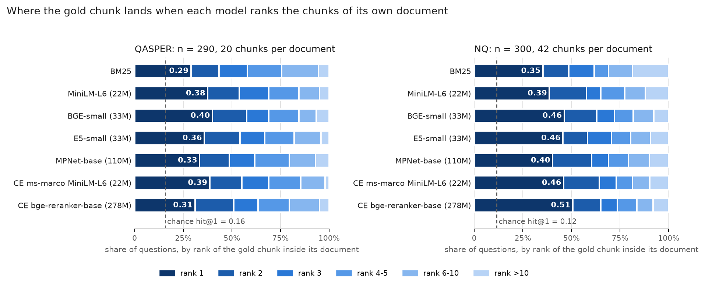
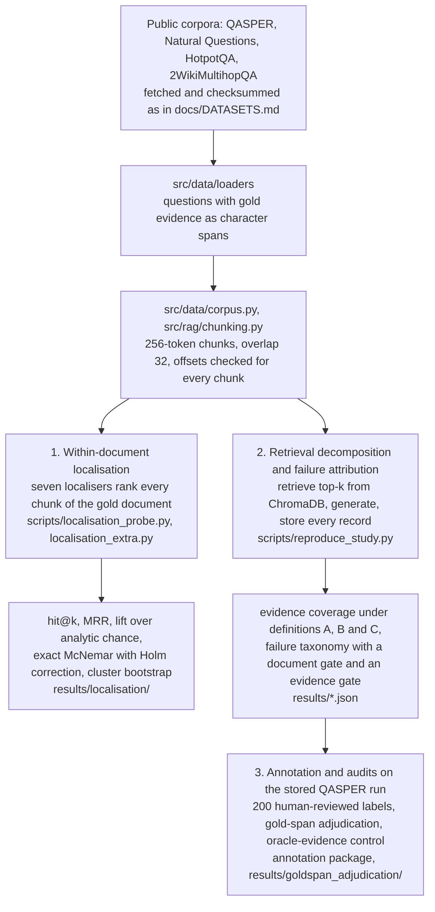
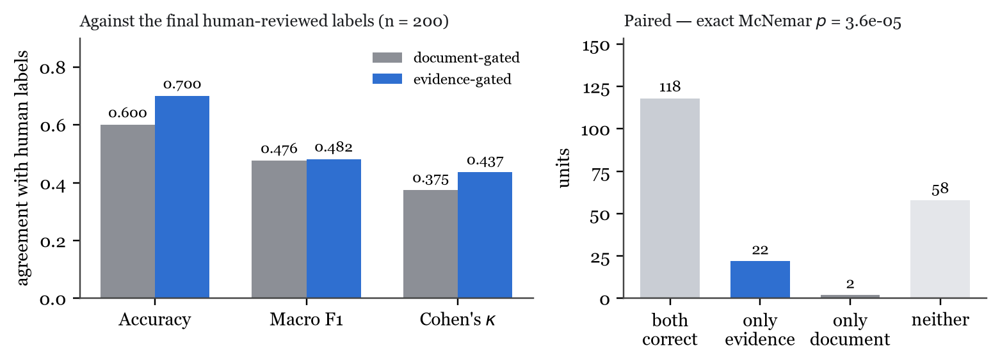
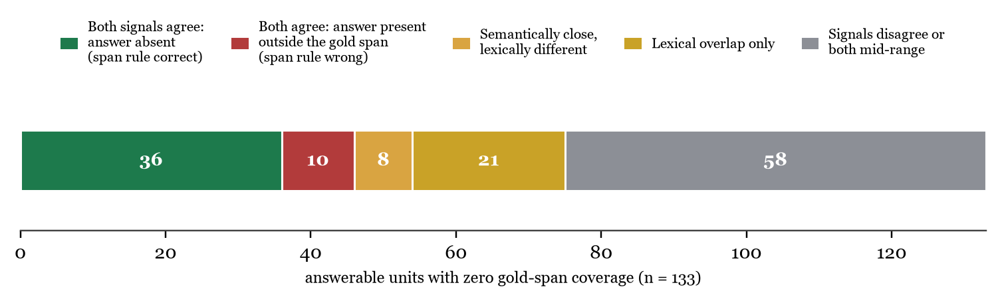
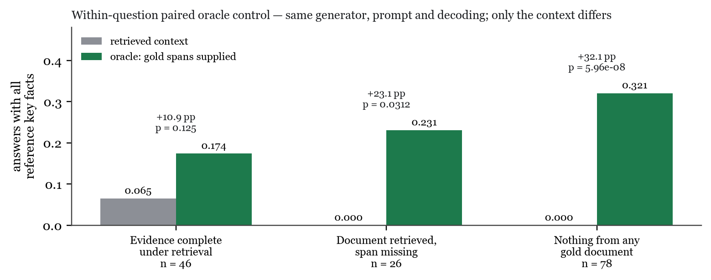

# TrustRAG

**Evidence-level evaluation for retrieval-augmented generation (RAG): once a retriever has
reached the right document, does it rank the passage that supports the answer first?**

[](https://github.com/pouyapd/TrustRAG/actions/workflows/ci.yml)

[](LICENSE)
[](https://github.com/pouyapd/TrustRAG/tree/v1.1.0)
[](https://doi.org/10.5281/zenodo.22879358)
[](https://doi.org/10.5281/zenodo.22879569)

**[Quickstart](#quickstart)** · **[Main findings](#main-findings)** ·
**[Reproduce the results](#reproducibility)** · **[Paper status and DOIs](#paper-status-and-identifiers)** ·
**[Datasets](docs/DATASETS.md)** · **[Cite](#citation)**



<sub>Each localiser ranks every chunk of the document that holds the gold evidence; the bars show
where the first chunk overlapping that evidence lands. Rank 1 (darkest) is reached for 0.29–0.40
of QASPER questions and 0.35–0.51 of NQ questions, against an analytic chance level of 0.16 and
0.12 (dashed line). Tables and per-question data: [results/localisation/](results/localisation/README.md).</sub>

**Contents:** [Overview](#overview) · [How it works](#how-it-works) · [Quickstart](#quickstart) ·
[Paper status and identifiers](#paper-status-and-identifiers) ·
[The problem](#the-problem-right-document-wrong-passage) · [What is evaluated](#what-the-framework-evaluates) ·
[Main findings](#main-findings) · [Human-reviewed attribution study](#human-reviewed-attribution-study) ·
[Gold-span completeness audit](#gold-span-completeness-audit) · [Oracle-evidence control](#oracle-evidence-control-a-replication) ·
[Decomposition and a withdrawn result](#retrieval-decomposition-and-a-withdrawn-result) ·
[Reproducibility](#reproducibility) · [Repository structure](#repository-structure) · [Tests](#tests) ·
[Limitations](#limitations) · [Version](#version-and-release) · [Citation](#citation) ·
[Contributing](#contributing) · [License](#license)

## Overview

A document-level retrieval metric counts any retrieved chunk of a relevant document as a success.
It cannot tell whether the chunk that reached the generator is the passage that supports the
answer, and a decision about *which stage failed*, retrieval or generation, depends on exactly
that. TrustRAG measures this gap. Every chunk keeps its character range in the source document, so
evidence coverage is interval arithmetic, not string search; a document-restricted localisation
protocol with an analytic chance level makes models and corpora comparable; a failure taxonomy can
gate its retrieval rule on document-level or span-level evidence; and the evidence annotations
that span-level scoring relies on are audited too.

TrustRAG proposes no retrieval method and claims no state-of-the-art result. It is a measurement
study: what happens inside the right document, on two public corpora, with the reference itself
audited.

| | |
|---|---|
| **Research question** | When a retriever has reached the right document, how often does it rank the evidence passage first, and does that depend on the model or the corpus? |
| **Contributions** | A within-document localisation protocol with a length-aware analytic chance level; seven localisers (BM25, four dense bi-encoders, two cross-encoder rerankers) under one protocol on two corpora; a failure taxonomy whose retrieval rule is scored against 200 human-reviewed labels; a completeness audit of the QASPER evidence annotations |
| **Datasets** | QASPER dev (290 questions) and Natural Questions validation (300 questions) for localisation; HotpotQA and 2WikiMultihopQA for the retrieval decomposition only. Corpora are not redistributed: loaders, download commands and checksums are in [docs/DATASETS.md](docs/DATASETS.md) |
| **Intended users** | Researchers who evaluate retrievers and rerankers for RAG at the level of evidence; builders of QA datasets whose evidence annotations serve as a scoring reference; readers checking the manuscript's numbers |
| **Requirements** | Python 3.11+, a CPU; no API key for anything reported |
| **Status** | Research code for a manuscript submitted to *Language Resources and Evaluation* and not yet peer-reviewed ([details](#paper-status-and-identifiers)) |

## How it works

The study follows three paths that share the same loaders and chunker. The module and script
names are the ones in this repository; [docs/ARCHITECTURE.md](docs/ARCHITECTURE.md#the-study-end-to-end)
gives the same map in more detail.



## Quickstart

Python 3.11 or newer (CI runs 3.12). Nothing below needs a GPU, an API key or a corpus download.

```bash
git clone https://github.com/pouyapd/TrustRAG.git && cd TrustRAG
python -m venv venv && source venv/bin/activate      # Windows: venv\Scripts\activate
pip install -r requirements.txt                      # service, evaluation, tests
python scripts/run_offline_eval.py                   # end-to-end run on the bundled sample corpus, seconds
pytest tests/ -q -rs                                 # some tests skip, with the reason, without the annotation package
```

Recompute one of the reported tables from the per-question ranks committed in the repository, and
check that it matches:

```bash
python scripts/localisation_robustness.py --hit-at-k qasper --out results/localisation/hit_at_k_qasper.json
git diff --stat results/                             # no output: identical to the committed file
```

`pip install -r requirements-research.txt` adds matplotlib, torch and transformers for the figures
and the local generators. `requirements.txt` sets lower bounds only, so a fresh install resolves
newer versions than the ones the results were produced with; to rebuild that exact environment
(Python 3.12.7), install [`requirements-lock.txt`](requirements-lock.txt) instead; its header says
how it was recorded. [Reproducibility](#reproducibility) lists what recomputes from a clone, from
the annotation package, and from the corpora and models. The FastAPI service
(`uvicorn src.api.main:app`) and the Docker setup are the pipeline the evaluation wraps;
[docs/QUICKSTART.md](docs/QUICKSTART.md) covers them.

## Paper status and identifiers

**Right Document, Wrong Passage: Evidence Localisation in Retrieval-Augmented Generation Evaluation
on QASPER and Natural Questions.** Pouya Bathaei Pourmand, 2026.

**Status (9 October 2026):** submitted to *Language Resources and Evaluation* (Springer) on
23 September 2026; passed technical checks on 28 September 2026; awaiting editorial assignment.
It has not been peer-reviewed, accepted or published, and this line will be updated when that
changes. The manuscript is not in the repository.

The manuscript reports the code and results at tag
**[v1.1.0](https://github.com/pouyapd/TrustRAG/tree/v1.1.0)**. Four identifiers are involved, and
they point to different things:

| Identifier | What it points to |
|---|---|
| Git tag [`v1.1.0`](https://github.com/pouyapd/TrustRAG/tree/v1.1.0) (23 September 2026) | The code and result state the manuscript reports. It adds the completed gold-span adjudication to v1.0.0. It exists on GitHub only: it has no Zenodo deposit and no DOI of its own, because everything it adds is tracked in the repository. |
| [10.5281/zenodo.22879358](https://doi.org/10.5281/zenodo.22879358) | Zenodo version DOI of the **code archive of release v1.0.0** (21 September 2026). |
| [10.5281/zenodo.22879569](https://doi.org/10.5281/zenodo.22879569) | Zenodo version DOI of the **human annotation package** (SHA-256 `d6d84ecb155853939be2b6d482caedb808915e29aa54498fb78c7d09502ea44d`), under CC BY 4.0 because it excerpts QASPER text (see [Reproducibility](#reproducibility)). |
| [10.5281/zenodo.22879357](https://doi.org/10.5281/zenodo.22879357) | Zenodo **concept DOI** of the record that holds both deposits. It resolves to the latest version in the record, which is currently the annotation package, and the DOI registry (DataCite) lists it as a CC BY 4.0 dataset, so it is not a DOI for the code. |

**Findings in one paragraph.** Every chunk of the document that holds the gold evidence is ranked against
the question by seven localisers — BM25, four dense bi-encoders and two cross-encoder rerankers,
22M–278M parameters — on QASPER (290 questions, NLP papers) and Natural Questions (300 questions,
Wikipedia), under one protocol and a length-aware analytic chance level. Rank-1 localisation stays
at or below about half the questions for every model and corpus (hit@1 0.29–0.51) while hit@5
reaches 0.69–0.86; the median rank is 2 for almost every model, and the models miss different
questions. BM25 is the weakest localiser on both corpora, differences among the bi-encoders are
not significant after Holm correction, and the cross-encoder reranker effect does not replicate
across corpora. An author-conducted annotation study of 200 QASPER units finds that gating failure
attribution on span coverage agrees with the human labels more often than gating on document
coverage (accuracy 0.700 against 0.600), and an author-conducted, blind adjudication of 97 of the
133 zero-coverage units puts the incompleteness of the QASPER span annotations at 0.053, about
5–7% once the 36 units that were left unadjudicated are allowed for. The results argue for
reporting localisation against chance and for auditing evidence annotations before they serve as
a scoring reference.

## The problem: right document, wrong passage

A gold span and a retrieved chunk are half-open character intervals in the same document.
Positive overlap is evidence coverage:

```
document  qasper:1901.00001
gold span        [1200, 1760)
retrieved chunk  [ 900, 2100)   overlap = 560 chars  ->  evidence covered
retrieved chunk  [8300, 9500)   overlap =   0 chars  ->  same document, no evidence
```

Both chunks satisfy a document-level metric; only the first makes the question answerable from
context. Three definitions of retrieval success follow — **A**: some chunk from a relevant document
(the conventional metric); **B**: every document a multi-hop question requires; **C**: a retrieved
chunk contains the gold span — with `C ≤ B ≤ A` by construction. The A→C gap is large on
long-document corpora (16.6 pp on QASPER, 26.7 pp on NQ at *k* = 5; see
[below](#retrieval-decomposition-and-a-withdrawn-result)). That the gap exists is
[prior work](docs/paper/literature_review.md). TrustRAG asks what remains once the right document
has been reached: does the retriever rank the evidence passage first inside it, does that depend on
the model or the corpus, and how far can the span annotations used to score it be trusted?

## What the framework evaluates

**Within-document localisation protocol.** For every answerable question, *all* chunks of the gold
document (256 tokens, overlap 32, character offsets verified `document[start:end] == chunk.text`)
are ranked against the question by a localiser; the rank of the first chunk overlapping a gold span
is recorded. No other document competes, so the measurement is about localisation only. The
expected hit@*k* and MRR under a random ordering of that document's *D* chunks with *m* gold chunks
are computed analytically, which makes corpora with different document lengths comparable and gives
a lift over chance for every model. Statistics: exact McNemar on paired hit@1 with Holm correction
over all 21 model pairs per corpus, exact sign tests on reciprocal ranks, Wilson intervals,
Spearman rank correlation, union analysis, and a document-level cluster bootstrap because QASPER
questions cluster in papers. Also measured: hit@*k* for *k* ∈ {1, 3, 5, 10, 20}, near-miss mass at
ranks 2–5, the trade-off between admitting more chunks of the reached document and reach, chunk
size (128/256/512), and descriptive corpus contrasts (offered as hypotheses, not tested causes).

**Seven localisers, identical protocol on both corpora.**

| Localiser | Family | Parameters |
|---|---|---|
| BM25 (Okapi, k1 = 1.5, b = 0.75, corpus-level IDF) | lexical | — |
| `sentence-transformers/all-MiniLM-L6-v2` | dense bi-encoder | 22M |
| `BAAI/bge-small-en-v1.5` | dense bi-encoder | 33M |
| `intfloat/e5-small-v2` | dense bi-encoder | 33M |
| `sentence-transformers/all-mpnet-base-v2` | dense bi-encoder | 110M |
| `cross-encoder/ms-marco-MiniLM-L-6-v2` | cross-encoder reranker | 22M |
| `BAAI/bge-reranker-base` | cross-encoder reranker | 278M |

Model revisions actually run, input limits and documented training data:
[results/localisation/model_metadata.json](results/localisation/model_metadata.json).

**Datasets.** Corpora are not redistributed; loaders, download commands, checksums and licence
metadata are committed ([docs/DATASETS.md](docs/DATASETS.md)).

| Dataset | Licence | Structure | Used for |
|---|---|---|---|
| QASPER (dev) | CC BY 4.0 | NLP papers, ~20 chunks per gold document, evidence paragraphs (2.09 spans per question) | localisation, human study, gold-span audit, oracle control, decomposition |
| Natural Questions (validation) | CC BY-SA 3.0 | Wikipedia pages, ~42 chunks per gold document, one long answer | localisation, decomposition |
| HotpotQA, 2WikiMultihopQA | CC BY-SA 4.0, Apache-2.0 | 10 paragraphs, 2–4 gold | the A→B quantifier effect in the decomposition only |

**Failure taxonomy with two retrieval gates.** Nine categories, one rule (R4) that decides whether
a row is charged to retrieval. The document-gated variant binds R4 to definition A, the
evidence-gated variant to definition C; everything else is identical and both labels are written to
every row, so the comparison runs on the same retrieval output at no extra inference cost
([docs/TAXONOMY.md](docs/TAXONOMY.md)).

## Main findings

The rank distributions are in the figure at the [top of this page](#trustrag).

| | QASPER (n = 290) | NQ (n = 300) |
|---|---|---|
| Chance hit@1 (random order of the document's chunks) | 0.157 | 0.116 |
| hit@1, seven localisers | 0.290 – 0.400 | 0.353 – 0.507 |
| hit@5, seven localisers | 0.755 – 0.855 | 0.690 – 0.837 |
| Best single localiser at rank 1 | BGE-small 33M, 0.400 | bge-reranker-base 278M, 0.507 |
| Weakest neural localiser at rank 1 | bge-reranker-base 278M, 0.310 | MiniLM 22M, 0.387 |
| Some localiser ranks the gold chunk first | 0.769 | 0.780 |
| Pairs significant after Holm (of 21) | 2 (both BM25 deficits) | 6 |

Per localiser, hit@1 / hit@5 (from [`hit_at_k_qasper.json`](results/localisation/hit_at_k_qasper.json)
and [`hit_at_k_nq.json`](results/localisation/hit_at_k_nq.json), recomputed from the stored ranks):

| Localiser | QASPER hit@1 | QASPER hit@5 | NQ hit@1 | NQ hit@5 |
|---|---:|---:|---:|---:|
| BM25 | 0.290 | 0.755 | 0.353 | 0.690 |
| MiniLM-L6 (22M) | 0.376 | 0.845 | 0.387 | 0.773 |
| BGE-small (33M) | 0.400 | 0.845 | 0.463 | 0.817 |
| E5-small (33M) | 0.359 | 0.821 | 0.457 | 0.803 |
| MPNet-base (110M) | 0.334 | 0.797 | 0.403 | 0.793 |
| ms-marco-MiniLM cross-encoder (22M) | 0.386 | 0.855 | 0.460 | 0.813 |
| bge-reranker-base (278M) | 0.310 | 0.797 | 0.507 | 0.837 |

**What replicates on both corpora.** Every model places the evidence near the top of its document
but rarely first: the median rank is 2 for almost every model, a third to a half of gold chunks sit
at ranks 2–5, and the misses are only partly shared (union of seven at rank 1 0.77–0.78 against a
best single model of 0.40–0.51). BM25 is the weakest localiser on both corpora and the only model
whose deficit survives Holm correction on both; it localises at 0.84–0.89 when the gold chunk is
the lexically most question-like chunk of its document and at 0.04–0.06 otherwise. The 110M
bi-encoder trails the 33M ones on both corpora, though no difference among the bi-encoders is
significant after correction. No association between reaching the document and localising inside
it was detected on QASPER (Fisher exact *p* 0.31–0.63; power is limited), and the pairwise
conclusions hold under the document-level cluster bootstrap.

**What does not replicate.** The 278M cross-encoder reranker is the best localiser on NQ
(+4 to +12 pp hit@1 over the bi-encoders, significantly above MiniLM and MPNet after correction,
though its lead over BGE-small is not significant, *p* = 0.19) and the worst neural localiser on
QASPER, below every bi-encoder and indistinguishable from BM25. The corpora differ in ways
consistent with this — QASPER papers are more topically homogeneous chunk-to-chunk (mean
intra-document cosine 0.58 vs 0.46), their gold evidence shares no content word with the question
about four times as often (8.3% vs 2.0%), and web QA is in the documented training data of every
neural model tested while scientific-paper QA is in none — but these contrasts are descriptive;
they suggest hypotheses and do not establish causes.

**The claim that survives both corpora.** Increasing retriever or reranker capacity does not
produce a consistent improvement in rank-1 evidence localisation, and the localisation term is
closed only by admitting more of the reached document (hit@1 0.29–0.40 → hit@5 0.76–0.86 →
hit@10 0.93–0.98 on QASPER), at the price of reach; no fixed document-first allocation beats flat
top-*k* at equal budget. Conditional span coverage at a fixed cut-off is therefore not a measure of
ranking skill: two retrievers can cover the span at similar rates while ranking it very
differently inside the document, if one admits more chunks from it. Full tables, pairwise tests,
correlations, sweeps, corpus contrasts and limitations:
[results/localisation/README.md](results/localisation/README.md).

## Human-reviewed attribution study



200 QASPER units were annotated by the author under written guidelines
([docs/ANNOTATION_GUIDELINES.md](docs/ANNOTATION_GUIDELINES.md)) in a blinded package built by
[`scripts/build_annotation_package.py`](scripts/build_annotation_package.py). Provenance is
stated exactly because it matters: an audit against the guidelines flagged 43 of the 200 labels as
conflicting with an explicit rule; the annotator re-reviewed those 43 on full context (36 changed,
7 upheld); 22 labels come from a pilot on a truncated display and were never re-judged (none of the
22 was among the 43). The final 200 labels are therefore 135 original full-context labels, 43
review decisions and 22 pilot-era labels, with a per-unit chain `original → flag reason → review →
final`.

| Variant | Accuracy | 95% CI | Macro F1 | κ |
|---|---:|---:|---:|---:|
| Document-gated | 0.600 | 0.531–0.665 | 0.476 | 0.375 |
| **Evidence-gated** | **0.700** | 0.633–0.759 | **0.482** | **0.437** |

Paired over the same units: 118 both correct, **22 only evidence-gated**, 2 only document-gated,
58 neither; exact McNemar *p* = 3.6 × 10⁻⁵. Per class (evidence-gated): `wrong_retrieval` F1 0.907
(support 136), `answered_when_unanswerable` 1.000 (9), `partial_answer` 0.286 (22), `ok` 0.158
(32), `incorrect_answer` 0.059 (1). Retrieval-side attribution is where the gate helps;
generation-side classes are not reliable, and a held-out threshold ablation (144 configurations,
50/50 split, [`scripts/threshold_ablation.py`](scripts/threshold_ablation.py)) moves the evidence
gate only from 0.730 to 0.750 on the held-out half — the rules, not the thresholds, are the larger
problem.

**This is agreement with a guided expert reading, not independent validation.** There is one
annotator (the author), no inter-annotator agreement, and the second pass was directed by an audit
of the same guidelines under test. Agreement with an earlier *automated* (language-model) reference
pass is higher (0.805, κ 0.630) than with the human labels; the human number is the one reported.
Full account: [docs/paper/human_validation_final.md](docs/paper/human_validation_final.md).

## Gold-span completeness audit



Span-level scoring assumes the annotated spans are the only places the answer can be derived from.
QASPER marks supporting paragraphs, not every sufficient passage, so a retriever that returns a
different but sufficient passage is scored as a failure. The audit asks, for the 133 answerable
units with zero gold-span coverage, whether the reference answer is derivable from the retrieved
text alone. Two proxies (content-word overlap and MiniLM cosine) resolved 46 units where they agreed
(36 answer absent, 10 answer present); the 87 they could not resolve were stratified, and 60 were
sampled (seed 20260907) and adjudicated by hand, blind to every previous label and score
([`scripts/build_goldspan_adjudication.py`](scripts/build_goldspan_adjudication.py)):
**4 YES, 56 NO, 0 CANNOT_TELL**. A second round then adjudicated the 27 unresolved units the
sample had not drawn and the 10 the proxies had called "answer present", under the same protocol
and the same blind sheet ([`scripts/build_goldspan_remainder.py`](scripts/build_goldspan_remainder.py),
[`scripts/render_goldspan_review.py`](scripts/render_goldspan_review.py),
[`scripts/score_goldspan_adjudication.py`](scripts/score_goldspan_adjudication.py)):
**3 YES, 34 NO, 0 CANNOT_TELL**. That brings 97 of the 133 units to a human judgement.

| | Result |
|---|---|
| Gold-span under-coverage among the 133 zero-coverage units | **0.053** — 7 units, counted, no sampling error |
| Units carrying a human judgement | **97 of 133** |
| Range once the 36 unadjudicated units are allowed for | **5% – 7%** |

Because every unresolved unit was judged, the figure is a direct count rather than a sample
estimate and there is no sampling error left to report. Two things it does not settle. The 36
units both proxies called "answer absent" were never read by a person and are counted as holding
no under-coverage; if they behaved like the 97 that were adjudicated the rate would be 0.072,
which is where the 5–7% range comes from. And the same person judged both rounds, so the second
round adds coverage, not agreement: there is still one annotator, no inter-annotator agreement,
and one corpus. What the audit supports is that the span reference is a substantially sound
instrument for retrieval attribution — the bias runs in the expected direction and is an order of
magnitude smaller than the effects measured — and that annotation completeness can be measured at
low cost before annotations are used as a scoring reference. It also shows the proxies should not
have been trusted on their own: of the 10 units they were confident about, 3 were confirmed.

## Oracle-evidence control (a replication)



150 QASPER questions answered twice by the same generator (Qwen2.5-0.5B-Instruct), same prompt,
same decoding; only the context differs (retrieved chunks vs the gold spans verbatim).

| Stratum | n | retrieved | oracle | difference | p |
|---|---:|---:|---:|---:|---:|
| Evidence complete under retrieval | 46 | 0.065 | 0.174 | +10.9 pp | 0.125 (7 discordant; indicative) |
| **Document retrieved, span missing** | 26 | **0.000** | **0.231** | **+23.1 pp** | 0.031 (6 discordant; indicative) |
| Nothing from any gold document | 78 | 0.000 | 0.321 | +32.1 pp | 6.0 × 10⁻⁸ |

The middle row is the argument: those 26 questions count as retrieval *successes* under a
document-level metric, the model got none right, and supplying the actual span repairs 23% of them.
The experiment replicates [arXiv:2608.08944](https://doi.org/10.48550/arXiv.2608.08944) (32.8%
repair over 11,105 failures) at n = 150 with one small reader and no sham control; the two smaller
strata have too few discordant pairs for their *p*-values to carry weight.

## Retrieval decomposition and a withdrawn result

The A/B/C decomposition on four corpora (dense retrieval, `all-MiniLM-L6-v2`, *k* = 5, 256-token
chunks) isolates a *quantifier* effect (A→B, multi-hop completeness) from a *granularity* effect
(B→C, span coverage); the two are near-orthogonal, each null on the corpus where the other
dominates. Full protocol and threats to validity: [docs/EXPERIMENTS.md](docs/EXPERIMENTS.md).

| Corpus | n | A | B | C | quantifier A→B | granularity B→C |
|---|---:|---:|---:|---:|---:|---:|
| QASPER dev | 290 | 0.441 | 0.441 | 0.276 | 0.0 pp | **16.6 pp** (p = 7.1e-15) |
| Natural Questions | 300 | 0.997 | 0.997 | 0.730 | 0.0 pp | **26.7 pp** (p = 1.7e-24) |
| HotpotQA | 150 | 0.993 | 0.507 | 0.507 | **48.7 pp** (p = 2.1e-22) | 0.0 pp |
| 2WikiMultihopQA | 150 | — | — | — | **64.7 pp** (p = 1.3e-29) | 1.3 pp (n.s.) |

**A result we reported and then withdrew.** An earlier version of this repository claimed that the
document/span choice reverses the BM25-vs-dense comparison. It does not: the finding was an
evidence-mode defect in our own BM25 baseline (QASPER declares `any_sufficient` evidence, the
baseline hard-coded `all_required`, and 51% of QASPER questions carry more than one span, so BM25's
span coverage was under-reported at 0.183 instead of 0.321). Corrected, **no inversion occurs on
any corpus**: BM25 leads at both granularities on QASPER (0.528/0.321 vs 0.441/0.276; paired 40
vs 27, p = 0.142, n.s.) and dense leads at both on NQ (53 vs 27, p = 0.0049) and HotpotQA, stable
across *k* = 1…20 and chunk sizes 128/256/512. Conditional on reaching a gold document at *k* = 5
the two cover the span at similar rates (60.8% vs 62.5%) — which the localisation study shows is a
coincidence of the top-*k* cut, not equal ranking skill: BM25 ranks worse inside the document and
compensates by admitting more chunks from it (3.2 vs 2.7). The withdrawal is kept on record here
and in the manuscript.

## Reproducibility

Everything the manuscript reports traces to a file in this repository or to the annotation package
deposited with the Zenodo record:

| Available in the repository | Where |
|---|---|
| Localisation protocol, seven-localiser runs, cross-encoders and variants | [`scripts/localisation_probe.py`](scripts/localisation_probe.py), [`localisation_extra.py`](scripts/localisation_extra.py) |
| Consolidated metrics, Holm-corrected pairwise tests, sign tests, Wilson intervals, Spearman, union analysis, figure | [`localisation_report.py`](scripts/localisation_report.py), [`localisation_analysis.py`](scripts/localisation_analysis.py), [`localisation_figure.py`](scripts/localisation_figure.py) |
| Robustness: document-level cluster bootstrap, chunk audit, model metadata, hit@k from stored ranks, reach × localisation Fisher tests | [`localisation_robustness.py`](scripts/localisation_robustness.py) |
| Admission-budget and chunk-size sweeps; corpus contrasts | [`localisation_admission.py`](scripts/localisation_admission.py), [`localisation_contrast.py`](scripts/localisation_contrast.py) |
| Stored per-question rows and summaries for every localisation table | [`results/localisation/`](results/localisation/README.md) (29 files; file table in its README) |
| A/B/C decomposition, sweeps, BM25 baseline, oracle-evidence control | [`reproduce_study.py`](scripts/reproduce_study.py), [`run_bm25_baseline.py`](scripts/run_bm25_baseline.py), [`run_oracle_evidence.py`](scripts/run_oracle_evidence.py); outputs in [`results/`](results/) |
| Annotation tooling: blinded package build, offline annotation server, validation, guideline audit, review subset, final dataset with provenance, scoring | [`build_annotation_package.py`](scripts/build_annotation_package.py), [`annotate.py`](scripts/annotate.py), [`audit_human_annotations.py`](scripts/audit_human_annotations.py), [`build_review_subset.py`](scripts/build_review_subset.py), [`build_final_human_dataset.py`](scripts/build_final_human_dataset.py), [`score_annotations.py`](scripts/score_annotations.py) |
| Gold-span audit: lexical/semantic proxies, blind adjudication sheet, stratified estimator | [`audit_gold_span_coverage.py`](scripts/audit_gold_span_coverage.py), [`audit_gold_span_semantic.py`](scripts/audit_gold_span_semantic.py), [`build_goldspan_adjudication.py`](scripts/build_goldspan_adjudication.py), [`score_goldspan_adjudication.py`](scripts/score_goldspan_adjudication.py) |
| Threshold ablation, truncation audit | [`threshold_ablation.py`](scripts/threshold_ablation.py), [`audit_annotation_truncation.py`](scripts/audit_annotation_truncation.py) |
| Statistics (Wilson, exact McNemar, bootstrap, Holm) | [`src/evaluation/statistics.py`](src/evaluation/statistics.py) |
| Human study and gold-span documentation | [`docs/paper/human_validation_final.md`](docs/paper/human_validation_final.md), [`docs/paper/`](docs/paper/README.md) |
| Analysis → command → output map | [`docs/paper/reproducibility.md`](docs/paper/reproducibility.md) |

**Not in the git tree.** The raw corpora (fetched from their original sources with the commands and
checksums in [docs/DATASETS.md](docs/DATASETS.md)); model weights (pulled from Hugging Face on
first use); and `reports/`, which holds the run records and the annotation package — annotation
labels are data, not a computation, so the package (200 units with full retrieved context,
original/review/final labels with provenance, guideline and truncation audits, gold-span
adjudication sheet and answers, threshold-ablation and oracle-evidence rows; QASPER excerpts under
CC BY 4.0) is deposited as a separate checksummed archive (SHA-256 `d6d84ecb15585393…`) as the
second version of the Zenodo record of release v1.0.0: version DOI
[10.5281/zenodo.22879569](https://doi.org/10.5281/zenodo.22879569) (concept DOI
10.5281/zenodo.22879357; the code archive is version 10.5281/zenodo.22879358). The gold-span
labels and estimates carry no QASPER text and are tracked here instead, in
[`results/goldspan_adjudication/`](results/goldspan_adjudication/), so Table 9 recomputes from a
clone alone; the adjudication sheets, which do quote QASPER, stay in the archive and are
regenerated by the scripts in the tag.

**Provenance recorded in the result files.** Run reports written by the evaluation runner embed
the git commit and dirty flag, the raw-file SHA-256, the configuration, the threshold fingerprint
and package versions ([`src/evaluation/provenance.py`](src/evaluation/provenance.py)). In
`results/`, that full block is in the four run summaries (`qasper_dev_300.json`,
`nq_val_300_fixed.json`, `hotpot_150.json`, `twowiki_150.json`); the five `decomp_*.json` files
and the two localisation summaries record the commit and package versions but no raw-file
checksum. All eleven were written from a working tree with uncommitted changes
(`"dirty": true`), and they list eight packages: torch, transformers and scipy were not tracked
at the time. The per-question localisation rows, the BM25 baseline files and the derived analyses
record their configuration but no commit, input checksum or package versions. The raw-file
checksums are in [docs/DATASETS.md](docs/DATASETS.md); the model revisions, recovered from the
local cache after the runs, are in
[`results/localisation/model_metadata.json`](results/localisation/model_metadata.json).
Approximate nearest-neighbour search moves fine-grained decomposition aggregates by ≤ 0.001
between independently built indices; the localisation study has no randomness (stable argsort of
deterministic scores).

**Reproducing the analyses.** Three levels, from cheapest to most complete. The commands write
into the tracked files under `results/`; in a clone, `git diff --stat results/` then shows what
changed and `git checkout -- results/` restores the committed files.

*From a clone alone* — seconds, no corpus or model download. On 9 October 2026 each command
below, run in a fresh clone of `v1.1.0` with the then-current versions of the packages in
`requirements.txt`, reproduced its committed file byte for byte; the summary matched in every
field outside its provenance block.

```bash
pip install -r requirements.txt
python scripts/localisation_robustness.py --hit-at-k qasper --out results/localisation/hit_at_k_qasper.json
python scripts/localisation_robustness.py --hit-at-k nq --out results/localisation/hit_at_k_nq.json
python scripts/localisation_robustness.py --reach-association qasper --out results/localisation/reach_association_qasper.json
python scripts/localisation_robustness.py --bootstrap qasper --out results/localisation/robustness_qasper.json
python scripts/localisation_report.py --dataset qasper \
    --probe results/localisation/within_document_qasper.json \
    --extra results/localisation/localisers_qasper.json \
    --reranker results/localisation/reranker_bge_base_qasper.json \
    --out results/localisation/summary_qasper.json    # pairwise tests, Holm, Wilson, union
python scripts/score_goldspan_adjudication.py \
    --package results/goldspan_adjudication/first_pass \
    --remainder results/goldspan_adjudication/remaining37 \
    --audit results/goldspan_adjudication/gold_span_semantic.json \
    --out results/goldspan_adjudication/remaining37/estimate_combined.json   # Table 9
```

Figures, from a clone: the BM25 and gold-span figures build from tracked files; the oracle and
human-study figures need the annotation package, and the script says so and skips them.
Rendered with matplotlib 3.11.2, the two clone-built figures were pixel-identical to the
committed ones (only the matplotlib version tag in the PNG metadata differs).

```bash
pip install -r requirements-research.txt
python scripts/make_paper_figures.py --all --out-dir figures_check   # leaves results/figures alone
```

*With the annotation package* ([10.5281/zenodo.22879569](https://doi.org/10.5281/zenodo.22879569)):
unzip it and copy its `reports/` folder into the repository root. The human-study and oracle
analyses then run as listed in [docs/paper/human_validation_final.md](docs/paper/human_validation_final.md)
§7 and [docs/paper/reproducibility.md](docs/paper/reproducibility.md), `make_paper_figures.py`
draws all four figures, and the tests that need the package stop skipping.

*With the corpora and models* — minutes to hours on a CPU. Fetch the corpora
([docs/DATASETS.md](docs/DATASETS.md)), then `python scripts/reproduce_study.py --all` re-runs the
A/B/C decomposition on four corpora and the commands in
[results/localisation/README.md](results/localisation/README.md) re-run the localisation study
(runtimes are listed there).

## Repository structure

```
src/
  data/loaders/      QASPER, Natural Questions, HotpotQA, 2WikiMultihopQA loaders (+ parquet variants)
  data/              corpus chunking with character offsets, identity checks, licence metadata
  rag/               chunker, embedders (query prefixes per model), vector store, providers, local LLM
  evaluation/        evidence coverage, metrics, statistics, failure taxonomy, records, provenance, runner
  api/, monitoring/  the FastAPI service and Prometheus metrics of the pipeline (not used by the study)
scripts/             38 scripts: localisation_*.py, run_*.py, build_*/audit_*/score_*.py, reproduce_study.py,
                     threshold_ablation.py, make_*figures.py, report_tables.py, curate_results.py
results/
  localisation/      per-question rows, summaries, tests, bootstrap, sweeps, contrasts, hit@k, figure, README
  figures/           decomposition, oracle, human-validation and gold-span figures
  *.json             A/B/C decomposition, BM25 baseline and sweep outputs
docs/
  EXPERIMENTS.md     decomposition protocol, all results, threats to validity
  TAXONOMY.md, EVALUATION.md, ANNOTATION_GUIDELINES.md, DATASETS.md, ARCHITECTURE.md, QUICKSTART.md
  paper/             supporting documents for the manuscript, with the stage of each (docs/paper/README.md)
tests/               25 test modules, 514 tests
data/documents/, data/eval/   the small sample corpus used by the offline pipeline smoke test
CITATION.cff, .zenodo.json, LICENSE, pyproject.toml, CHANGELOG.md
```

## Tests

```bash
pytest tests/ -q -rs                 # 514 tests; -rs lists any skipped test and why
ruff check src/ tests/ scripts/      # clean
```

Tests that need the annotation package, a finished experiment run under `reports/`, or
matplotlib skip, with the reason, when those are absent, so a fresh clone runs the suite without
failures but with some skips.

Unit tests, property-style invariants (span coverage implies document coverage for every record;
the offset identity for every chunk), end-to-end integration from a dataset file through chunking
and retrieval to a failure label, statistical helpers against known values, a test that recomputes
hit@k and the reach tests from the committed localisation rows, and a regression test for every
defect found during the work — including the 600-character annotation-display truncation that hid
retrieved evidence from the annotator and biased labels toward blaming retrieval. CI runs lint,
tests, an evaluation regression and a Docker build on pushes to `main` and `research/**`
branches and on pull requests to `main`.

## Limitations

Read before quoting any number above.

- **One annotator, and a guided review.** The human study is author-conducted; there is no
  inter-annotator agreement, and the second pass was directed by an audit of the guidelines being
  tested. 22 of the 200 labels retain pilot-era provenance.
- **The gold-span figure is not definitive.** 0.053 — 7 of the 133 units, counted, no sampling
  error — but one adjudicator judged both rounds, the 36 units both proxies called "answer
  absent" were never read (allowing for them gives about 5–7%), and it is measured on QASPER
  only.
- **Generation-side categories are unvalidated**; several have near-zero support in the human
  labels, and the annotated run uses an extractive control that cannot hallucinate.
- **Two corpora, one chunking, small models.** Seven localisers with one reranker per size class,
  revisions recorded after the fact; no claim is made about other corpora, chunkers or larger
  models, and the corpus contrasts are descriptive, not causal.
- **Reach × localisation** was tested on QASPER only (NQ reach is saturated) with limited power.
- **The oracle control** has n = 150, one small reader, no sham control, and two strata with too
  few discordant pairs.
- **The core premise is prior art.** This is a measurement study, not a new evaluation paradigm
  ([docs/paper/literature_review.md](docs/paper/literature_review.md)).
- **Not a deployed system** — containerised and CI-tested, never run at production scale.

## Version and release

`v1.1.0` (23 September 2026) is the state of the code, result files and documentation that the
manuscript reports. It adds the completed gold-span adjudication: the second round of labels, the
combined estimate and the scripts that build and score them
([`results/goldspan_adjudication/`](results/goldspan_adjudication/)).
`v1.0.0` (21 September 2026) was the first research release and is the version archived on Zenodo.
Anything the manuscript cites is fixed at the `v1.1.0` tag, and a change to a cited result file
would be tagged again. Release notes: [CHANGELOG.md](CHANGELOG.md).

## Citation

`CITATION.cff` is the source of truth (GitHub's "Cite this repository" reads it). Until the article
exists, cite the software release. Version 1.1.0 has no DOI of its own, so the entry carries none:

```bibtex
@software{bathaeipourmand_trustrag_2026,
  author  = {Bathaei Pourmand, Pouya},
  title   = {{TrustRAG}: evidence localisation and failure attribution for retrieval-augmented generation evaluation},
  version = {1.1.0},
  year    = {2026},
  url     = {https://github.com/pouyapd/TrustRAG/tree/v1.1.0},
  note    = {Git tag v1.1.0, not deposited on Zenodo. Archived code release v1.0.0:
             doi:10.5281/zenodo.22879358. Annotation package: doi:10.5281/zenodo.22879569}
}
```

To cite the annotation package itself, use its version DOI,
[10.5281/zenodo.22879569](https://doi.org/10.5281/zenodo.22879569).

The manuscript *Right document, wrong passage: evidence localisation in retrieval-augmented
generation evaluation on QASPER and Natural Questions* was submitted to *Language Resources and
Evaluation* on 23 September 2026 and is awaiting editorial assignment; a citation to the article
will replace the software citation if it is published.

## Contributing

Issues and pull requests are welcome, in particular reports of a number that does not reproduce,
broken links or commands, and corrections to the documentation.

- Run `pytest tests/ -q -rs` and `ruff check src/ tests/ scripts/` before opening a pull request;
  CI runs both.
- Leave the files the manuscript reports unchanged: `results/localisation/`,
  `results/goldspan_adjudication/`, `results/figures/` and `results/*.json` are fixed at tag
  `v1.1.0`. If one of them is wrong, open an issue; a correction is made as a new tagged version
  with a [CHANGELOG](CHANGELOG.md) entry, never by editing the tag.
- Put a new analysis in a folder of its own, say in its README that it is not part of the
  manuscript, and record the commit, inputs and configuration it was produced with.
- Do not commit corpus files or text excerpted from them; the corpora are fetched as described in
  [docs/DATASETS.md](docs/DATASETS.md).

## License

MIT for the code and the result files ([LICENSE](LICENSE)). The evaluated corpora carry their own
licences ([docs/DATASETS.md](docs/DATASETS.md)); the annotation package excerpts QASPER text and is
distributed under CC BY 4.0.

## Author

Pouya Bathaei Pourmand — independent researcher, Genoa, Italy.
