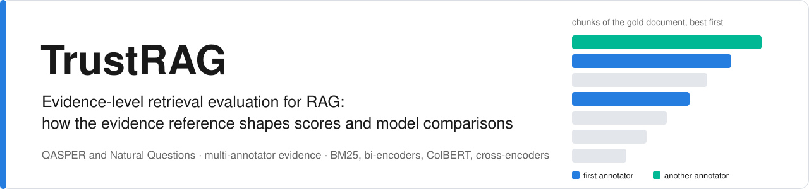
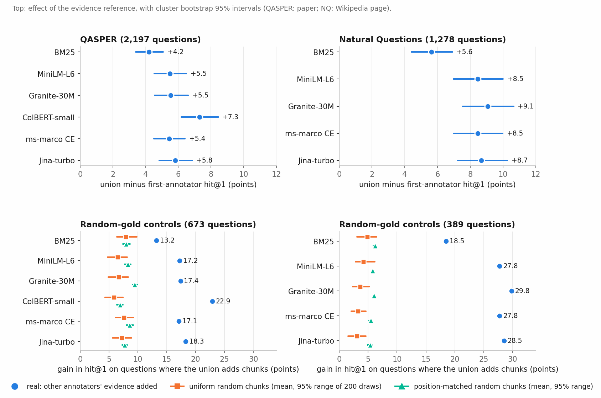
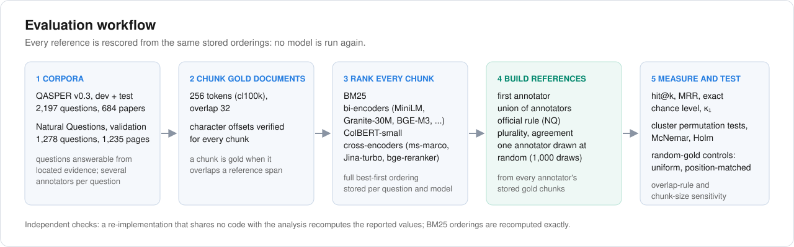

<p align="center">
  
</p>

[](https://github.com/pouyapd/TrustRAG/actions/workflows/ci.yml)

[](LICENSE)
[](https://doi.org/10.5281/zenodo.22879358)
[](https://doi.org/10.5281/zenodo.22879569)

**TrustRAG is a research project on evidence-level evaluation of retrieval for retrieval-augmented
generation (RAG).** A retriever is credited only when it ranks the passage that supports the answer,
judged against human evidence annotations. When several annotators marked evidence, the evaluator
has to combine their annotations into one reference, and that rule is part of the measurement.

**Research question.** How much do evidence-level scores, and the comparisons drawn from them, depend
on how the evidence reference is built, and how often does a single-annotator reference count valid
evidence as a miss?

**Contribution.** A measurement of reference dependence on two corpora with multi-annotator evidence,
the controls needed to interpret it (an exact chance level, uniform and position-matched random-gold
controls, cluster-level tests), and reporting recommendations. Every per-question chunk ordering and
every annotator's gold chunks are released, so any reference can be rescored without rerunning a
model. The study proposes no retrieval method.

**Status.** The study is reported in a single-author journal manuscript, which has not been published.
The code and results of the earlier study, *Right document, wrong passage* (tag `v1.1.0`), are
documented in [docs/EARLIER_STUDY_2026-09.md](docs/EARLIER_STUDY_2026-09.md).

**[Main findings](#main-findings)** · **[Protocol](#evaluation-protocol)** ·
**[Reproduce](#reproduce-the-results)** · **[Data and licences](#datasets-and-licences)** ·
**[Repository map](#repository-map)** · **[Cite](#citation)**

## Main findings

<p align="center">
  
</p>

On 2,197 QASPER questions (684 papers) and 1,278 Natural Questions (NQ) questions (1,235 Wikipedia
pages), with BM25, bi-encoders, ColBERT-small and cross-encoders:

| | QASPER | Natural Questions |
|---|---|---|
| hit@1 gain, first annotator → union of annotators | +4.2 to +7.3 points | +5.6 to +9.1 points |
| Same gain, chance-corrected (κ₁) | +1.5 to +6.0 points | +4.4 to +8.6 points |
| Spread from redrawing a single annotator (central 95%) | 1.2–1.5 points | 1.6–2.0 points |
| Real gain ÷ gain from uniform random chunks | 1.7–3.9× | 3.8–9.3× |
| Real gain ÷ gain from position-matched random chunks | 1.7–3.3× | 3.0–5.3× |
| Extra union gain of neural models over BM25 | +1.2 to +3.1 points; significant for 2 of 5 | +2.8 to +3.4 points; significant for 4 of 4 |
| Pairs whose significance depends on the reference | 1 of 15 | 1 of 10 |
| Annotator pairs with disjoint gold chunks | 20% | 14% |
| Krippendorff's α, chunk level (95% interval) | 0.65 (0.63–0.67) | 0.81 (0.78–0.85) |
| Rank-1 misses that another annotator marked as gold | 8–14% | 10–18% |

- **The rule matters more than the annotator.** Moving from the first annotator to the union raises
  rank-1 localisation for every model on both corpora, with cluster bootstrap intervals that exclude
  zero; redrawing the annotator under a fixed rule moves it by at most 2.0 points.
- **The gain is not chance or proximity alone.** Part of it is mechanical (a union marks more
  chunks), and part reflects proximity: other annotators' evidence is often next to the first
  annotator's. Against random chunks at the same distance, models still rank other annotators'
  evidence first 1.7–5.3 times as often, and the cluster interval of the difference excludes zero
  for every model. The controls do not show that this is recognition of valid evidence as such.
- **Single-annotator references compress model differences.** Significantly different models never
  change order, but the union helps neural localisers more than BM25. On NQ, MiniLM-L6 leads BM25 by
  2.2 points under the first annotator (Holm-adjusted p = 0.31) and by 5.0 points under the union
  (p = 0.004).
- **Single references penalise valid evidence.** A share of every model's rank-1 misses are passages
  another annotator marked, and the share is highest for the strongest models.

**Scope.** The reference effects hold under two alternative overlap rules fixed in advance. Other
chunk sizes (128 and 512 tokens) were tested only on 290/300-question subsets with three models.
The models are small enough for a laptop CPU; stronger retrievers were not tested. A small
derivability adjudication (7 of 133 units) has one adjudicator and no reliability estimate.

## Evaluation protocol

<p align="center">
  
</p>

- **Within-document localisation.** Every chunk of the gold document (256 cl100k tokens, overlap 32,
  character offsets verified) is ranked against the question; the rank of the first chunk that
  overlaps the reference is recorded, and an exact, length-aware chance level
  `P(rank ≤ k) = 1 − C(D−m, k) / C(D, k)` makes documents of different lengths comparable.
- **References.** First annotator, union, NQ's official rule, plurality, QASPER's agreement
  reference, and one annotator drawn at random per question (1,000 draws).
- **Inference.** Paired permutation tests at cluster level (QASPER paper, NQ Wikipedia page),
  Holm-corrected over all pairs, with the exact McNemar test as a secondary analysis; cluster
  bootstrap intervals; power analysis.
- **Controls and sensitivity.** Uniform and position-matched random-gold controls; two alternative
  overlap rules; chunk sizes of 128 and 512 tokens on subsets; ties; sample splits.
- **Verification.** An independent re-implementation that shares no code with the analysis
  recomputes the reported values; recomputed BM25 scores reproduce every stored ordering; the scorer
  reproduces the earlier study's stored ranks.

Models: BM25 (Okapi), all-MiniLM-L6-v2, granite-embedding-30m-english, ms-marco-MiniLM-L-6-v2 and
jina-reranker-v1-turbo-en on both full samples; answerai-colbert-small-v1 on full QASPER and the NQ
subset; bge-m3 (dense) and four earlier-study models on the 290/300-question subsets.

## Reproduce the results

Python 3.11 or newer; no GPU, API key or corpus download is needed for the analyses.

```bash
git clone https://github.com/pouyapd/TrustRAG.git && cd TrustRAG
python -m venv venv && source venv/bin/activate     # Windows: venv\Scripts\activate
pip install -r requirements.txt krippendorff matplotlib
cd studies/reference_sensitivity_2026-11
python scripts/cluster_inference.py                 # primary tests and reference effects
python scripts/position_control.py                  # position-matched random-gold control
pytest tests -q
```

[`studies/reference_sensitivity_2026-11/README.md`](studies/reference_sensitivity_2026-11/README.md)
lists the full pipeline in order, with run times, the outputs each step writes, and the steps that
need the corpora or the models. The per-question files in `results/raw/` contain no dataset text.

## Datasets and licences

| Dataset | Licence | How to obtain |
|---|---|---|
| QASPER v0.3 (dev and test) | CC BY 4.0 | [allenai.org/data/qasper](https://allenai.org/data/qasper); see [docs/DATASETS.md](docs/DATASETS.md) |
| Natural Questions (validation, first two files of the Hugging Face release) | CC BY-SA 3.0 | [Hugging Face](https://huggingface.co/datasets/google-research-datasets/natural_questions); see [docs/DATASETS.md](docs/DATASETS.md) |
| Derivability annotation package | CC BY 4.0 | Zenodo, [10.5281/zenodo.22879569](https://doi.org/10.5281/zenodo.22879569) |

Neither corpus is redistributed here. The code and the text-free result files are under the MIT
licence ([LICENSE](LICENSE)).

## Repository map

```
studies/reference_sensitivity_2026-11/   current study: scripts, text-free orderings, analyses, audits, tests
src/                                     loaders, chunker with character offsets, embedders, evaluation code
scripts/                                 earlier-study scripts (localisation, decomposition, annotation)
results/                                 earlier-study result files, fixed at tag v1.1.0; results/exploratory/
docs/                                    datasets, architecture, the earlier study (EARLIER_STUDY_2026-09.md), figures
tests/                                   test suite of the framework
```

The FastAPI service and Docker setup that the earlier evaluation wraps are described in
[docs/QUICKSTART.md](docs/QUICKSTART.md).

## Citation

`CITATION.cff` is the source of truth (GitHub's "Cite this repository" reads it). Until an article
exists, cite the software release:

```bibtex
@software{bathaeipourmand_trustrag_2026,
  author  = {Bathaei Pourmand, Pouya},
  title   = {{TrustRAG}: evidence localisation and failure attribution for retrieval-augmented generation evaluation},
  version = {1.1.0},
  year    = {2026},
  url     = {https://github.com/pouyapd/TrustRAG/tree/v1.1.0},
  note    = {Git tag v1.1.0, not deposited on Zenodo. Archived code release v1.0.0:
             doi:10.5281/zenodo.22879358. Annotation package: doi:10.5281/zenodo.22879569}
}
```

To cite the annotation package itself, use its version DOI,
[10.5281/zenodo.22879569](https://doi.org/10.5281/zenodo.22879569).

## Author

Pouya Bathaei Pourmand, independent researcher, Genoa, Italy.
ORCID [0009-0000-6875-6275](https://orcid.org/0009-0000-6875-6275).
The research questions, experimental design and scientific decisions are the author's; implementation
was AI-assisted (Claude Code), and every reported number is regenerated by the scripts in this
repository and checked by an independent re-implementation.
